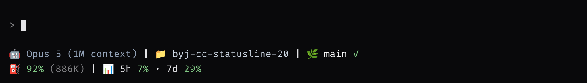

# byj-cc-statusline

> **byj** = **B**it**Y**oung**J**ae

[](https://opensource.org/licenses/MIT) 

## 📊 Overview

A curated statusline for Claude Code (CC) - showing only the essentials. Displays context usage like a car's fuel gauge and API utilization at a glance.

**Lightweight:** Single bash script, `jq` its only dependency — and no network calls at all.



## 📖 What Each Part Shows

### 🤖 Model Name

Shows the current Claude model you're using.

```
🤖 Sonnet 4.5
```

### 📁 Directory / Session Name

Normally the current working directory name (not the full path, just the folder name).

Claude Code can now send messages between sessions, and it addresses a peer session by
**name**. Since a name it derives is just `<folder>-XX`, showing it next to the folder
would only repeat it — so the name takes the folder's place:

```
📁 my-project-a4
```

That is the exact string another session uses to message this one. After `/rename`, when
the name no longer tells you the folder, both are shown:

```
📁 my-project | 🏷️ fuel-gauge-fix
```

The name comes from Claude Code's own session registry (`~/.claude/sessions/`), read on
every render, so it follows a `/rename` with no restart. If there is no entry for the
session, the folder name is shown alone, exactly as before.

### 🌿 Git Status

Git branch name with colored status indicators:

| Symbol | Meaning                 | Example          |
| ------ | ----------------------- | ---------------- |
| 🔴     | Modified files (unstaged)| `🌿 main 🔴`    |
| 🟢     | Staged files            | `🌿 main 🟢`    |
| 🟡     | Untracked files         | `🌿 main 🟡`    |
| ✅     | Clean - no changes      | `🌿 main ✅`    |

Symbols can combine: `🌿 main 🔴🟢` = modified + staged files

> **Note:** In the actual terminal, these are displayed as ANSI-colored dots (`●`) and checkmark (`✓`).

### ⛽ Fuel Gauge

Shows remaining safe context before autocompact triggers.

**Format:** `⛽ XX% (XXK)` where:

- **XX%** = Percentage of safe space remaining
- **(XXK)** = Actual token count remaining

**Color coding:**

- 🟢 Green (≥70%): Safe - plenty of space
- 🟡 Yellow (30-70%): Caution - moderate usage
- 🔴 Red (<30%): Warning - autocompact imminent (icon changes to ⚠️)

**Example:** `⛽ 36% (57K)` means:

- 36% of safe space left
- 57,000 tokens remaining before autocompact

### 📊 API Usage Gauge

Shows Anthropic API utilization from the Usage API.

**Format:** `📊 5h XX% · 7d XX%` where:

- **5h XX%** = 5-hour session utilization
- **7d XX%** = 7-day weekly utilization

**Color coding:**

- 🟢 Green (<50%): Low usage
- 🟡 Yellow (50-80%): Moderate usage
- 🔴 Red (≥80%): High usage
- Dimmed `~XX%` (e.g. `~20%`): stale value — that window already reset; shown until the next refresh lands

**Where the numbers come from:** Claude Code hands these to the statusline directly, refreshed from the rate-limit headers of every API response. Nothing is fetched, so there is no token, no request, and nothing that can be rate-limited or time out.

## 🚀 Installation

### Recommended: Clone and install

```bash
git clone https://github.com/BitYoungjae/byj-cc-statusline.git
cd byj-cc-statusline
bash install-statusline.sh
```

The installer will:

- ✅ Check dependencies (jq)
- ✅ Backup existing configuration to `~/.local/share/byj-cc-statusline/backups/`
- ✅ Copy `bin/statusline.sh` to `~/.claude/`
- ✅ Update `~/.claude/settings.json`

### Alternative: Remote install (no clone required)

```bash
curl -fsSL https://raw.githubusercontent.com/bityoungjae/byj-cc-statusline/main/install-statusline.sh -o /tmp/install.sh && \
curl -fsSL https://raw.githubusercontent.com/bityoungjae/byj-cc-statusline/main/bin/statusline.sh -o /tmp/statusline.sh && \
STATUSLINE_SOURCE=/tmp/statusline.sh bash /tmp/install.sh
```

### Manual install

```bash
# 1. Copy statusline script
cp bin/statusline.sh ~/.claude/
chmod +x ~/.claude/statusline.sh

# 2. Update settings.json
# Add to ~/.claude/settings.json:
{
  "statusLine": {
    "type": "command",
    "command": "~/.claude/statusline.sh",
    "padding": 0
  }
}

# 3. Restart Claude Code
```

## 📋 Requirements

- **Claude Code** v2.0+ — the 5h/7d gauge additionally needs a build that sends `rate_limits` on stdin (verified on 2.1.267)
- **jq** - JSON parser

Install dependencies:

```bash
# macOS
brew install jq

# Linux
sudo apt install jq  # Ubuntu/Debian
sudo yum install jq  # CentOS/RHEL
```

## ⚙️ How the Fuel Gauge Works

The fuel gauge reads `context_window` data provided by Claude Code via stdin, including `context_window_size` and current token usage.

Claude Code reserves buffer space for context management:

| Auto-compact Setting | Buffer Size | Safe Limit (200K) | Safe Limit (1M) |
|---------------------|-------------|-------------------|-----------------|
| **ON** (default)    | 33K (fixed) | 167K              | 967K            |
| **OFF**             | 3K (fixed)  | 197K              | 997K            |

Autocompact setting is read from `~/.claude.json`.

**Calculation example (auto-compact ON, 200K context):**

```
Total context:     200,000 tokens
Autocompact buffer: 33,000 tokens (fixed)
─────────────────────────────────────────
Safe limit:        167,000 tokens

Current usage:      97,830 tokens
Remaining fuel:     69,170 tokens → ⛽ 41%
```

The percentage shows how much safe space you have left before hitting the buffer threshold.

## ⚙️ How the API Usage Gauge Works

Claude Code tracks your 5h and 7d rate limits from the headers on every API response
and passes them to the statusline on stdin. The statusline just reads them:

```json
"rate_limits": {
  "five_hour": { "used_percentage": 7.0, "resets_at": 1789038600 },
  "seven_day": { "used_percentage": 29.0, "resets_at": 1789444800 }
}
```

That makes the gauge **fresher than polling** (it moves with every response rather than
on a 180-second timer) and completely free — no OAuth token, no HTTP request, nothing
that can be rate-limited, time out, or need a lock.

Two details are worth knowing:

- **A brand-new session has no numbers yet.** The data is built up from responses, so
  before you send your first message there is nothing to show.
- **A window disappears the moment it resets**, until the next response brings the fresh
  one.

A small cache at `~/.cache/byj-cc-statusline/rate-limits.json` covers both gaps. Every
render saves what it displayed, merged per window, so a new session opens with the last
known values and a just-reset window keeps showing its previous reading. Anything served
from the cache past its reset time is dimmed with a `~` (e.g. `~20%`) so it is never
mistaken for a live number.

> Earlier versions polled `GET /api/oauth/usage` with an OAuth token, a 180s cache, a
> single-flight lock and capped exponential backoff. Reading stdin replaced all of it.

## 📁 Project Structure

```
byj-cc-statusline/
├── README.md                  # This file
├── LICENSE                    # MIT License
├── CLAUDE.md                  # Claude Code instructions
├── .gitignore                 # Git ignore rules
├── install-statusline.sh      # Automated installer
└── bin/
    └── statusline.sh          # Core statusline script
```

## 🛠️ Troubleshooting

**Statusline not working?**

- Ensure jq is installed: `which jq`
- Restart Claude Code

**Fuel gauge shows nothing?**

- Start a conversation first (requires usage data)

**Session name not showing?**

- Only the folder name appears when Claude Code has not registered the session for
  cross-session messaging — older versions have no `~/.claude/sessions/` registry. This
  is a silent fallback, not a failure; nothing else on the line is affected.

**API usage not showing?**

- Send a message first — a session has no rate-limit data until its first API response
- Run the built-in diagnostic: `bash ~/.claude/statusline.sh --doctor` — shows the fallback cache, window expiry, and any leftover files from the old polling path
- If it never appears, your Claude Code may be too old to send `rate_limits` on stdin
- Cache is at `~/.cache/byj-cc-statusline/rate-limits.json`

**Showing a dimmed `~20%`?**

- That is a cached value whose window has already reset — it refreshes on the next response

## 🔄 Updates

```bash
cd byj-cc-statusline
git pull
bash install-statusline.sh
```

Your existing settings will be automatically backed up to:
`~/.local/share/byj-cc-statusline/backups/`

## 📝 License

MIT License - see [LICENSE](LICENSE) file for details.

## 🔗 Links

- Repository: [https://github.com/BitYoungjae/byj-cc-statusline](https://github.com/BitYoungjae/byj-cc-statusline)
- Issues: [https://github.com/BitYoungjae/byj-cc-statusline/issues](https://github.com/BitYoungjae/byj-cc-statusline/issues)
