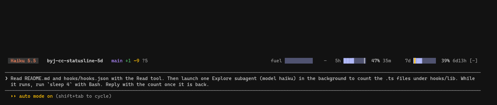
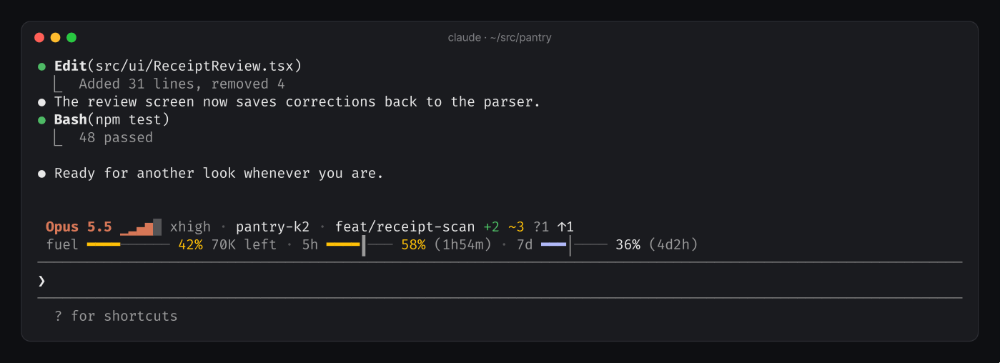
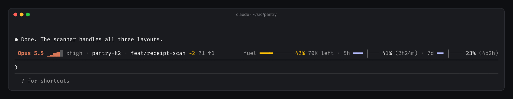

# byj-cc-statusline

A status band for [Claude Code](https://claude.com/claude-code) that sits right above the prompt.



This started out as a bash statusline. It is a Claude Code mod now, so instead of being re-run with a JSON blob it gets told when something changes. That lets it update while a turn is still running, redraw for whatever width you have, and show more when you point at it.

## Install

```
/plugin install byj-statusline --marketplace BitYoungjae/byj-cc-statusline
```

Type that at the Claude Code prompt, answer `y` to add the marketplace, then pick a scope. Mods need Claude Code 2.1.287 or newer.

Coming from the old bash version? Delete the `statusLine` entry in `~/.claude/settings.json`, or you will see both.

## Reading it

```
Opus 5.5 ▁▂▄▆█ xhigh · pantry-k2 · feat/receipt-scan +2 ~3 ?1 ↑1
fuel ━━━━────── 42% 70K left · 5h ━━━━┃─── 58% (1h54m) · 7d ━━━│──── 36% (4d2h)
```

**Model and effort.** The bars light up from `low` (one) to `max` (all five). It shows the level the last request was actually sent with, and follows `/effort` without waiting for the next request.

**Session name.** Other sessions message this one by the name `ListAgents` prints. A name Claude Code picked is just the folder plus a short suffix, so it takes the folder's place. After `/rename` the folder comes back and the name sits next to it as `@name`.

**Git.** `+` staged, `~` modified, `?` untracked, `!` conflicted, `↑` `↓` ahead and behind. It refreshes after any tool that can touch files.

**fuel.** Room left before auto-compact, measured against the point where Claude Code says it will compact. It moves during a turn, not only at the end. Yellow under 70%, red under 30%. In the red a `/compact` button appears; clicking it types the command into an empty prompt and leaves the Enter to you.

**5h and 7d.** Plan usage and the time until each window resets. The tick on the bar is where you would be if you used the window evenly. Fill past the tick means you are going faster than that, and when that pace would hit the limit before the reset, the tick turns amber. A window that has reset since the last reply keeps its old value, dimmed, like `~64%`, until the next reading comes in.

While everything is fine the colors stay quiet. Yellow and red only show up when something needs a look.

## Pointing at things



Rest the pointer on a part and a card opens above the band:

- **model**: the full id and the effort level
- **session name**: what the name is for, and the full path
- **branch**: the counts spelled out, and what is left to push or pull
- **fuel**: tokens left, what is filling the context, how much the last turn added, and about how many more turns like it fit
- **5h / 7d**: how much of the window is gone, where you will end up at this pace, when it resets

Clicking the model, the session name, the folder or the branch copies it. If clicks don't reach the band in your terminal, `ctrl+x tab` focuses it and Enter presses the focused item.

## Narrow windows



Everything goes on one line when it fits, otherwise on two. Each line then trims itself on its own: first the reset times go and the bars get shorter, then the bars and the effort meter go. If that is still not enough, whole parts drop out in this order: cost, 7d, the `@name` tag, 5h, git. The model, the session name and fuel always stay.

## Options

In `/config`, under byj-statusline:

| Option | Default | |
|---|---|---|
| `layout` | `auto` | `two-line` keeps the two lines apart even when one would fit |
| `icons` | `symbols` | `emoji` brings back the old statusline's look |
| `details` | on | the hover cards |
| `showCost` | off | adds the session's cost |
| `alerts` | on | a toast when fuel drops under 30%, when a window passes 90%, or when a window past half is on pace to run out before it resets |

## What it reads

The numbers come from Claude Code itself: usage and rate limits from the session, the effort from each request, the compaction point from the same breakdown `/context` uses. Besides that it reads `~/.claude/sessions/*.json` for the session name and `effortLevel` from your settings, and runs `git status`. The last rate-limit reading is kept in the plugin's storage so a new session has numbers before its first reply. It makes no network calls.

## Hacking on it

```sh
git clone https://github.com/BitYoungjae/byj-cc-statusline
claude --plugin-dir ./byj-cc-statusline    # load it for one session; edits reload live
claude plugin test ./byj-cc-statusline     # unit and UI tests
claude plugin validate ./byj-cc-statusline
```

`hooks/register.tsx` collects the numbers. How they look is decided in `hooks/lib/`, which never talks to the engine, so most of it is tested as plain functions.

## License

MIT
